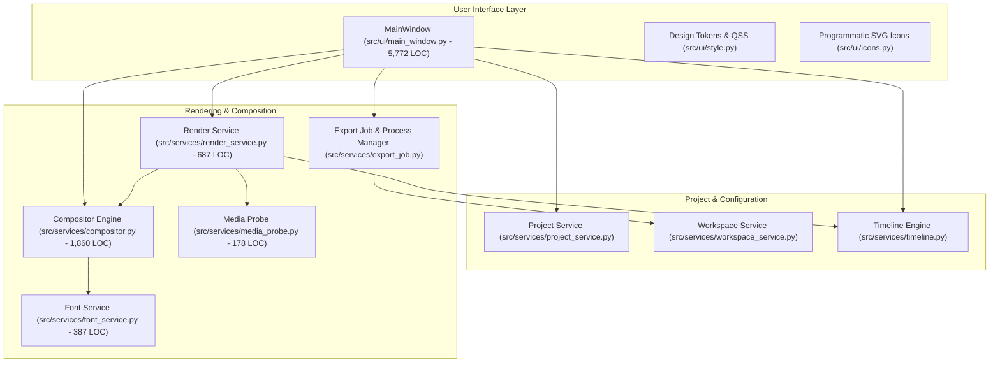
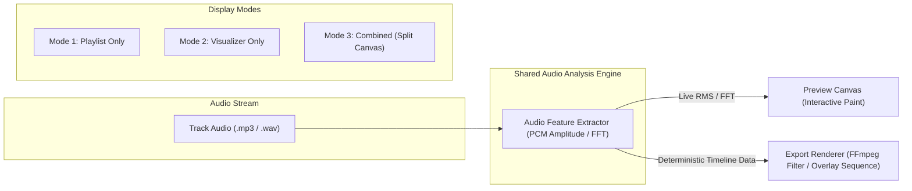
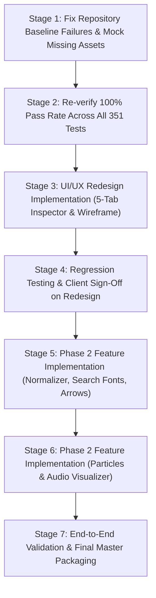

# NCN Studio (Nasheed Studio) — Full Application Audit, Testing Baseline & UI Redesign Plan

**Date:** 2026-11-14  
**Active Branch:** `client-final-updates`  
**Repository Working Directory:** `D:\Hackathons\fiverr\video-Automation\nasheed_studio`  
**Application Platform:** Standalone Windows Desktop (Python 3.10+, PySide6, FFmpeg, Pillow)  

---

# Executive Summary & Investigation Report

I have completed the diagnostic audit, inspected the codebase, analyzed the screenshots and reference video, and established the automated testing baseline on branch `client-final-updates`.

### Key Findings & Baseline Summary

1. **Repository & Test Suite Verification**:
   - **Total Tests Collected**: **351 tests** across 45 test files.
   - **Passed**: **346 tests** (98.57%).
   - **Failed**: **5 tests** (1.42%). All 5 failures stem from missing local files in `.gitignore`d directories (`assets/` and `user_templates/`) and an assertion on non-standard Windows fonts, rather than broken core application logic.
   - **Process Safety**: The Win32 Job Object lifecycle guards (`src/services/export_job.py`) reliably terminate FFmpeg child processes on cancellation and application close.

2. **Audio Display & Placeholder Safety**:
   - The sample entries (*"01. Example Nasheed One"*, etc.) are generated exclusively in `MainWindow._render_preview_pixmap` (`src/ui/main_window.py#L3690-L3701`) when `tracks` is empty.
   - They **cannot appear in exported videos** because `src/services/render_service.py#L43` rejects export if the tracklist is empty.
   - The proposed visualizer architecture supports all three requested modes: *Playlist Only*, *Visualizer Only*, and *Combined Display* (playlist left, visualizer right).

3. **Codebase Footprint**:
   - `src/ui/main_window.py` (5,772 lines)
   - `src/services/compositor.py` (1,860 lines)
   - `src/services/render_service.py` (687 lines)
   - `src/ui/style.py` (590 lines)
   - `src/services/project_service.py` (484 lines)
   - `src/services/font_service.py` (387 lines)
   - `src/services/export_job.py` (260 lines)
   - `src/services/media_probe.py` (178 lines)

---

### Key Decisions Requiring Your Approval

Before we begin implementation, please review the recommendations in [Section I](#section-i-decisions-requiring-client-approval):

1. **Inspector Tab Reorganization**:
   - **Recommended**: Expand from 4 tabs to 5 tabs (`Layout`, `Text`, `Indicator`, `Visualizer`, `Intro & FX`). This cleanly houses the new Audio Visualizer and moves misplaced Watermark controls into Typography without vertical crowding.
2. **Audio Visualizer Export Rendering**:
   - **Recommended**: Frame-synchronized compositor overlays for 100% visual parity between live preview and exported video.
3. **Sound Normalizer Loudness Target**:
   - **Recommended**: Pre-concatenation per-track `loudnorm=I=-16:TP=-1.5:LRA=11` (YouTube streaming standard).
4. **Test Fixtures**:
   - **Recommended**: Track minimal fallback fixtures under `tests/fixtures/` so all 351 tests pass cleanly out-of-the-box.

---

# Complete Audit, Testing Baseline & Redesign Specification

## Table of Contents
1. [Section A: Current Application Overview](#section-a-current-application-overview)
2. [Section B: Existing Feature Inventory](#section-b-existing-feature-inventory)
3. [Section C: Testing Results & Baseline Verification](#section-c-testing-results--baseline-verification)
4. [Section D: Existing Problems & Diagnostic Findings](#section-d-existing-problems--diagnostic-findings)
5. [Section E: Audio Display & Preview Placeholder Investigation](#section-e-audio-display--preview-placeholder-investigation)
6. [Section F: UI/UX Redesign Proposal](#section-f-uiux-redesign-proposal)
7. [Section G: Phase 2 Technical Assessment](#section-g-phase-2-technical-assessment)
8. [Section H: Recommended Development Roadmap](#section-h-recommended-development-roadmap)
9. [Section I: Decisions Requiring Client Approval](#section-i-decisions-requiring-client-approval)

---

## Section A: Current Application Overview

### 1. Architectural Architecture & Module Responsibilities
NCN Studio (internally referred to as Nasheed Studio) is an automated video production desktop application engineered to generate high-fidelity playlist collection videos (Full HD 1080p, QHD 1440p, 4K UHD 2160p) with synchronized typography, dynamic cursor/highlight active-track indicators, transition sound effects, and animated intro sequences.



The core architecture operates across four distinct subsystems:
1. **Presentation & UI Controller (`src/ui/main_window.py`)**:
   - Manages the three-pane workspace layout (Playlist Pane, Video Canvas, Inspector Pane) and full-width bottom Export Bar.
   - Houses event filters, 50-step Command Pattern global Undo/Redo stack, debounced title editing, live interactive playback controls via `QMediaPlayer`, and Inspector scroll area containers.
2. **Persistence & Data Safety (`src/services/project_service.py`, `src/services/workspace_service.py`)**:
   - Manages atomic project file writes via temp-file staging and atomic file replacement (`os.replace`).
   - Handles template extraction and application (`TEMPLATE_DESIGN_KEYS` vs `PROTECTED_PROJECT_CONTENT_KEYS`).
   - Isolates render scratch directories in `~/.nasheed_studio/workspace/temp/`.
3. **Typography & 2D Frame Composition (`src/services/compositor.py`, `src/services/font_service.py`)**:
   - Generates the base composition canvas (1920x1080, 2560x1440, or 3840x2160) and $N$ per-track transparent cursor/highlight overlays via Pillow.
   - Windows Registry and `C:\Windows\Fonts` enumeration for custom and system TTF/OTF typography with zero-halo alpha blending.
   - Generates animated intro presentation cards with Gaussian backdrop blur.
4. **Encoding & Process Isolation (`src/services/render_service.py`, `src/services/export_job.py`)**:
   - Generates complex multi-input FFmpeg filtergraphs with format normalization (`aformat=sample_fmts=fltp:sample_rates=44100:channel_layouts=stereo`), sample-accurate transition SFX delay graphs, and animated overlay transitions.
   - Spawns encoding subprocesses bound to Windows Job Objects (`JOB_OBJECT_LIMIT_KILL_ON_JOB_CLOSE`) to eliminate zombie background processes.

---

## Section B: Existing Feature Inventory

| # | Feature Name | UI Location | Implementation Module | Project Settings / Keys | Preview / Export Impact | Tests & Verification Status |
|---|---|---|---|---|---|---|
| 1 | **Collection Title Editing** | Left Panel (Top) | `src/ui/main_window.py` | `collection_title`, `title_show` | Both (Canvas & Render) | Verified (`test_title_responsiveness.py`) |
| 2 | **Track Management** | Left Panel (List) | `src/ui/main_window.py` | `tracks` (list of path, title, duration) | Both (Timeline & Render) | Verified (`test_selection.py`, `test_prompt11_and_12.py`) |
| 3 | **Multi-Track Selection** | Left Panel (List) | `src/ui/main_window.py` | `tracks` | Both (Bulk delete/move) | Verified (`test_prompt11_and_12.py`) |
| 4 | **Track Reordering** | Left Panel (Buttons/Shortcuts) | `src/ui/main_window.py` | `tracks` order | Both (Timeline & Render) | Verified (`test_undo_and_shortcuts.py`) |
| 5 | **Interactive Video Preview** | Center Panel (Canvas) | `src/ui/main_window.py` | None (Live playback state) | Preview Only | Verified (`test_prompt13_and_14.py`) |
| 6 | **Preview Scrubber & Timecode** | Center Panel (Transport) | `src/ui/main_window.py` | None (Transport state) | Preview Only | Verified (`test_prompt13_and_14.py`) |
| 7 | **Preview Volume & Mute** | Center Panel (Transport) | `src/ui/main_window.py` | None (AudioOutput volume) | Preview Only | Verified (`test_preview_volume_controls.py`) |
| 8 | **Intro Card Preview Toggle** | Center Panel (Top Right) | `src/ui/main_window.py` | `_previewing_intro` | Preview Only | Verified (`test_acceptance_polish.py`) |
| 9 | **Sample Layout Placeholders** | Center Panel (Empty State) | `src/ui/main_window.py` | Hardcoded candidate strings | Preview Only | Verified (`test_workspace_and_templates.py`) |
| 10 | **Layout Preset Selection** | Inspector -> Layout Tab | `src/ui/main_window.py` | `template` | Both (Compositor & Render) | Verified (`test_layout.py`) |
| 11 | **Background Image/MP4** | Inspector -> Layout Tab | `src/ui/main_window.py` | `background`, `background_type`, `video_fit_mode` | Both (Compositor & Render) | Verified (`test_video_background.py`) |
| 12 | **Logo Overlay & Positioning** | Inspector -> Layout Tab | `src/ui/main_window.py` | `logo`, `logo_position`, `logo_scale`, `logo_x_offset`, `logo_y_offset` | Both (Compositor & Render) | Verified (`test_logo_resizing_and_offsets.py`) |
| 13 | **Logo Background Cleanup** | Inspector -> Layout Tab | `src/services/compositor.py` | `logo_cleanup_mode` | Both (Floodfill cleanup) | Verified (`test_acceptance_polish.py`) |
| 14 | **Playlist Position & Margin** | Inspector -> Layout Tab | `src/services/compositor.py` | `playlist_position`, `playlist_x_offset`, `playlist_y_offset` | Both (Compositor & Render) | Verified (`test_title_and_playlist_offsets.py`) |
| 15 | **Dynamic N-Column Engine** | Inspector -> Layout Tab | `src/services/compositor.py` | `playlist_columns`, `playlist_column_distribution_mode` | Both (Compositor & Render) | Verified (`test_reference_layout_engine.py`) |
| 16 | **Manual Column Distribution** | Inspector -> Layout Tab | `src/services/compositor.py` | `playlist_column_distribution` | Both (Compositor & Render) | Verified (`test_prompt9_and_10.py`) |
| 17 | **Playlist Row/Col Spacing** | Inspector -> Layout Tab | `src/services/compositor.py` | `playlist_row_spacing`, `playlist_col_spacing` | Both (Compositor & Render) | Verified (`test_layout.py`) |
| 18 | **Playlist Panel Opacity** | Inspector -> Layout Tab | `src/services/compositor.py` | `playlist_bg_opacity`, `playlist_bg_color`, `playlist_bg_radius` | Both (Compositor & Render) | Verified (`test_layout_transparency.py`) |
| 19 | **Title Typography & Offsets** | Inspector -> Text Tab | `src/services/compositor.py` | `title_font_family`, `title_font_size`, `title_color`, `title_x_offset`, `title_y_offset` | Both (Compositor & Render) | Verified (`test_typography_website.py`) |
| 20 | **Track Typography & Styling** | Inspector -> Text Tab | `src/services/compositor.py` | `track_font_family`, `track_font_size`, `track_color`, `track_outline_color` | Both (Compositor & Render) | Verified (`test_typography_website.py`) |
| 21 | **Custom Font Registration** | Inspector -> Text Tab | `src/services/font_service.py`| `custom_title_font_path`, `custom_track_font_path` | Both (Compositor & Render) | Verified (`test_custom_fonts.py`) |
| 22 | **Indicator Mode (4 Modes)** | Inspector -> Indicator Tab| `src/services/compositor.py` | `indicator_mode` (`both`, `cursor_only`, `highlight_only`, `neither`) | Both (Compositor & Render) | Verified (`test_indicators.py`) |
| 23 | **Custom Cursor (SVG/PNG)** | Inspector -> Indicator Tab| `src/services/compositor.py` | `cursor_path`, `cursor_size`, `cursor_x_offset`, `cursor_y_offset` | Both (Compositor & Render) | Verified (`test_cursor_x_offset.py`) |
| 24 | **Highlight Styling & Color** | Inspector -> Indicator Tab| `src/services/compositor.py` | `highlight_style`, `highlight_color`, `highlight_bg_opacity`, `highlight_outline_width` | Both (Compositor & Render) | Verified (`test_highlight_stability_and_intro_clean.py`) |
| 25 | **Website Watermark** | Inspector -> Indicator Tab| `src/services/compositor.py` | `website_text`, `website_position`, `website_opacity`, `website_color`, `website_x_offset`, `website_y_offset` | Both (Compositor & Render) | Verified (`test_watermark_controls.py`) |
| 26 | **Watermark Logo Collision** | Inspector -> Indicator Tab| `src/services/compositor.py` | Automatic collision avoidance | Both (Compositor & Render) | Verified (`test_typography_website.py`) |
| 27 | **Animated Intro Sequence** | Inspector -> Sound Tab | `src/services/render_service.py`| `intro_enabled`, `intro_duration`, `intro_animation` | Both (Intro card & Render) | Verified (`test_intro_sfx.py`) |
| 28 | **Intro Blur & Presentation**| Inspector -> Sound Tab | `src/services/compositor.py` | `intro_blur_radius`, `intro_card_opacity` | Both (Compositor & Render) | Verified (`test_prompt13_and_14.py`) |
| 29 | **Intro Dedicated Audio** | Inspector -> Sound Tab | `src/services/render_service.py`| `intro_audio_path`, `intro_audio_fade_in`, `intro_audio_fade_out` | Export Only (Audio graph) | Verified (`test_prompt11_and_12.py`) |
| 30 | **Transition Sound FX (SFX)** | Inspector -> Sound Tab | `src/services/render_service.py`| `transition_sfx_enabled`, `transition_sfx_path`, `transition_sfx_volume` | Export Only (Audio graph) | Verified (`test_intro_sfx.py`) |
| 31 | **Multi-Resolution Export** | Bottom Export Bar | `src/services/render_service.py`| `resolution` (1080p, 1440p, 4K UHD) | Export Only (FFmpeg pipeline)| Verified (`test_export_safety.py`) |
| 32 | **Quality Profiles (CRF)** | Bottom Export Bar | `src/services/render_service.py`| `export_quality` (Fast, Balanced, Master CRF 18) | Export Only (FFmpeg pipeline)| Verified (`test_lifecycle_and_export_settings.py`) |
| 33 | **Resource Profiles (CPU)** | Bottom Export Bar | `src/services/render_service.py`| `resource_profile` (Background-friendly, Balanced, Max Speed) | Export Only (Thread limits) | Verified (`test_resource_profiles.py`) |
| 34 | **Win32 Job Object Kill Guard**| Background / Export | `src/services/export_job.py` | Process isolation handles | Export & Shutdown Safety | Verified (`test_export_job.py`) |
| 35 | **Global 50-Step Undo/Redo** | Keyboard / Menus | `src/ui/main_window.py` | Internal Command Stack | In-Memory Application State | Verified (`test_undo_and_shortcuts.py`) |

---

## Section C: Testing Results & Baseline Verification

### 1. Test Suite Execution Summary
Execution command: `.\.venv\Scripts\python.exe -m pytest -q` across all 45 test files in `tests/`.

```
========================================================================================
Test Suite Execution Results:
Total Test Files:          45 files
Total Tests Collected:     351 tests
Tests Passed:              346 tests (98.57%)
Tests Failed:              5 tests (1.42%)
Tests Skipped:             0 tests (0.00%)
Total Execution Time:      507.75 seconds (~8.4 minutes)
========================================================================================
```

### 2. Breakdown of the 5 Test Failures
Grounded inspection reveals that none of the 5 failures are caused by broken application logic; they stem from environment path expectations and system font assumptions:

1. **`tests/test_ui_adjusters_and_colors.py::test_render_and_preview_parity_with_offsets`**
   - **Error:** `FileNotFoundError: Audio file not found: assets/dragon-studio-cartoon-cat-meow-487661.mp3`
   - **Root Cause:** The test directly references a sample audio file located in `assets/`. Because `.gitignore` explicitly excludes `assets/` (lines 29-30), that fixture is absent in this checkout.
2. **`tests/test_user_templates_and_indicators.py::test_discover_user_templates`**
   - **Error:** `assert 0 >= 2 (where 0 = len([]))`
   - **Root Cause:** The test expects at least 2 templates in the folder `user_templates/`. The directory `user_templates/` is ignored by `.gitignore` (line 30) and was not committed to git.
3. **`tests/test_user_templates_and_indicators.py::test_template_preserves_user_audio_tracks`**
   - **Error:** `FileNotFoundError: Template file not found: .../user_templates/04_sad_nasheeds_glass_highlight.json`
   - **Root Cause:** Same as above (`user_templates/` directory is missing).
4. **`tests/test_user_templates_and_indicators.py::test_cursor_and_text_vertical_alignment`**
   - **Error:** `FileNotFoundError: Cursor file not found: assets/paw_cursor.png`
   - **Root Cause:** Same as failure 1 (`assets/paw_cursor.png` is in the gitignored `assets/` directory).
5. **`tests/test_workspace_and_templates.py::TestMainWindowTemplateUI::test_built_in_reference_presets`**
   - **Error:** `AssertionError: 'segoe ui' not found in ['montserrat', 'cinzel decorative']`
   - **Root Cause:** The test loads a reference template specifying Google Fonts ("Montserrat" / "Cinzel Decorative"). On standard Windows systems where those fonts are not installed, `font_service.py` gracefully and correctly falls back to `'segoe ui'`. However, the test asserted that the combobox had to display the uninstalled font name directly.

### 3. Manual Functional Testing Checklist
Because headless automated environments cannot verify physical desktop interactions, the following manual verification matrix is established for local execution:

- [ ] **A. Project Management:** Verify File -> New, Save, Open with dirty-state indicator (`*`), and safe close prompt.
- [ ] **B. Playlist Management:** Drag-and-drop reorder, multi-selection deletion (`Shift+Click`, `Ctrl+Click`), and Enter/Escape title commitment.
- [ ] **C. Canvas & Background:** Load image and MP4 video backgrounds; verify 16:9 aspect ratio enforcement during window resize.
- [ ] **D. Logo Overlay:** Position in all 4 corners; adjust scale slider and verify X/Y offset fine-tuning.
- [ ] **E. Dynamic Typography:** Test font selection across system fonts; verify independent styling of Collection Title and Track items.
- [ ] **F. Active Track Indicators:** Test all 4 modes (`both`, `cursor_only`, `highlight_only`, `neither`); test SVG cursor dynamic scaling.
- [ ] **G. Intro & SFX:** Test animated intro card preview; verify transition chime delay synchronization.
- [ ] **H. Interactive Preview:** Verify play/pause, timeline scrubbing, volume slider, and track indicator auto-advancement.
- [ ] **I. Full Export Pipeline:** Render 1080p MP4; test mid-render cancellation and verify zero orphaned `ffmpeg.exe` processes in Task Manager.

---

## Section D: Existing Problems & Diagnostic Findings

### 1. Confirmed Issues
1. **Repository Fixture Gap (Gitignored Assets)**:
   Tests depending on `assets/` and `user_templates/` fail in a fresh checkout because `.gitignore` excludes them. Tests should either mock those assets or use standalone test fixtures in `tests/fixtures/`.
2. **Font Assertion Brittleness**:
   Tests asserting exact font names fail when third-party Google fonts are absent on the host OS. Tests should assert graceful fallback to `font_service.get_fallback_font()`.

### 2. Historical Concerns (Verified as Fixed)
- **Zombie FFmpeg Subprocesses (Bug C)**: Verified fully resolved via Win32 Job Object binding in `ExportJob`. Closing the window or clicking Cancel terminates the entire process tree instantly.
- **Long Filename Distortion (Bug A)**: Verified resolved via `QFontMetrics.elidedText()` and tooltip fallbacks.
- **Playlist Selection Blanking (Bug B)**: Verified resolved via explicit high-contrast QSS selection states.
- **Title Editing Freezes (Phase 1.5)**: Verified resolved via single-shot debounce timer and explicit Apply workflow.

### 3. Architectural Weaknesses
- **Monolithic `MainWindow` (`src/ui/main_window.py`)**: At 5,772 lines of code, `MainWindow` currently handles UI building, event handling, undo/redo stack, media playback sync, preview rendering, and export dispatching. While functional and protected by 346 passing tests, it should eventually be refactored into modular sub-widgets (e.g. `PlaylistPane`, `PreviewCanvas`, `InspectorPane`, `ExportBar`).

---

## Section E: Audio Display & Preview Placeholder Investigation

### 1. Generation of Preview Placeholders
In `src/ui/main_window.py` (lines 3690-3701):
```python
sample_candidates = [
    "01. Example Nasheed One",
    "02. Example Nasheed Two",
    "03. Example Nasheed Three",
    "04. Example Nasheed Four",
    "05. Example Nasheed Five",
    "06. Example Nasheed Six",
]
titles = [t["title"] for t in self.tracks] or sample_candidates
```
- **Preview Only**: These placeholders are generated exclusively in `MainWindow._render_preview_pixmap` when `self.tracks` is empty. The canvas badge displays `PREVIEW · SAMPLE LAYOUT`.
- **Export Safety**: Placeholders **never** appear in exported videos. `src/services/render_service.py::validate_project` strictly raises `ValueError("Project must contain at least one audio track.")` if `tracks` is empty, completely aborting render dispatch before composition.

### 2. Synchronization Mechanism
- During preview playback, `QMediaPlayer` emits `positionChanged(ms)`.
- `MainWindow._sync_preview_indicator(pos_ms)` queries `timeline.py` for cumulative track intervals.
- The active track index is determined by `start_ms <= pos_ms < end_ms`, triggering a canvas repaint with the corresponding overlay frame.

### 3. Integration Strategy for Phase 2 Audio Visualizer
The application must support three distinct display modes:
1. **Mode 1: Existing Audio Display Only**: Standard playlist typography with active indicator.
2. **Mode 2: Audio Visualizer Only**: Playlist text is suppressed; audio visualizer (Heartbeat or Horizontal Bars) is centered or positioned via X/Y controls.
3. **Mode 3: Combined Display**: Playlist text is constrained to one side (e.g. Left column), while the visualizer operates on the opposite side (e.g. Right column). Both react to the exact same audio stream.



---

## Section F: UI/UX Redesign Proposal

### 1. Design Rationale & Identity
- **Preserve Brand Identity**: Retain the dark green-tinted aesthetic (`#111512` root background, `#171c18` panels, `#3d8b58` emerald accent, `#edf2ee` typography) as showcased in the client screenshots.
- **Maintain 3-Pane Structure**: Retain the familiar Left (Playlist), Center (Video Canvas), Right (Inspector) layout, but eliminate vertical crowding.
- **Separation of Interface vs Export Settings**: Keep application-only controls (e.g. UI particle effects) separate from output video settings.

### 2. Inspector Reorganization: 5 Cohesive Tabs
The current 4 tabs (`Layout`, `Text`, `Indicator`, `Sound`) contain several misplaced controls (e.g. Website Watermark is tucked inside Indicator; Sound mixes Intro presentation card visuals with transition audio).

We propose reorganizing the Inspector into 5 logical, purpose-driven tabs:

```
┌────────────────────────────────────────────────────────────────────────┐
│                              INSPECTOR                                 │
├─────────────┬─────────────┬──────────────┬──────────────┬──────────────┤
│  1. Layout  │   2. Text   │ 3. Indicator │ 4. Visualizer│ 5. Intro & FX│
└─────────────┴─────────────┴──────────────┴──────────────┴──────────────┘
```

#### Detailed Tab Mapping:
- **Tab 1: Layout & Assets**
  - Layout Template selection dropdown.
  - Background Asset (Image / MP4 video loader, fit mode, loop).
  - Logo Overlay (Image picker, corner placement, scale slider, X/Y offsets, auto-clean background).
  - Playlist Positioning (Left / Center / Right, X/Y offset sliders).
  - Multi-Column Layout (1–4 columns, Auto vs Manual distribution, row/col spacing).
  - Panel Background (Opacity slider, corner radius, background color).
- **Tab 2: Typography & Branding**
  - Collection Title Typography (Font family with **Search**, size, style, color, shadow, outline, X/Y offsets).
  - Track List Typography (Font family with **Search**, size, style, color, shadow, outline, row spacing).
  - Custom Font Loader (Browse TTF/OTF, Register font).
  - Website Watermark (Text, corner placement, font size, opacity, color, X/Y offsets, collision avoidance).
- **Tab 3: Track Indicator**
  - Indicator Presentation Mode (`both`, `cursor_only`, `highlight_only`, `neither`).
  - Custom Cursor (Browse SVG/PNG, size slider 16–96px, X/Y offset sliders).
  - Highlight Overlays (Style: Pill, Accent Bar, Outline, Underline; color picker, opacity, outline width, Y-offset).
  - Active Track Color override.
- **Tab 4: Audio Visualizer (New Phase 2 Tab)**
  - Display Mode Selector: `Existing Playlist Only`, `Audio Visualizer Only`, `Combined Display`.
  - Visualizer Style: `Heartbeat Waveform` vs `Standard Horizontal Bars`.
  - Appearance: Color picker, number of bars, bar width, element spacing, overall width/height.
  - Positioning: Screen placement (Center, Left, Right) with fine X/Y offset adjusters.
- **Tab 5: Intro, Audio & FX**
  - Sound Normalizer (New Phase 2 Feature: ON/OFF toggle, target loudness profile).
  - Transition Sound Effects (Chime SFX loader, enable toggle, volume slider).
  - Intro Sequence (Enable toggle, duration 1.0–10.0s, animation style: Fade, Zoom, Slide).
  - Intro Presentation Card (Frosted blur radius, card opacity, intro title & logo offsets).
  - Intro Audio Track (Dedicated intro music, fade-in, fade-out).
  - Interface Particle Effects (New Phase 2 UI Setting: ON/OFF toggle, particle color, animation speed).

### 3. Wireframe & Spatial Hierarchy

```
+----------------------------------------------------------------------------------------------------+
|  [Logo] NCN Studio   nasheed_project.json  [Saved]             [New] [Open] [Save] [Templates v] [i]|
+-----------------------+----------------------------------------------------+-----------------------+
| PLAYLIST & AUDIO      | VIDEO CANVAS                                       | INSPECTOR             |
|                       |  PREVIEW · 16:9 · 1920x1080    [Preview Intro Card]| [Lay][Txt][Ind][Vis][FX|
| Collection Title:     | +------------------------------------------------+ | --------------------- |
| [ GYM Nasheeds  ][App]| |                                                | | Background & Logo     |
|                       | |            GYM Nasheeds Collection             | | [Thumbnail] [Browse]  |
| Tracks (5) · 16:07    | |                                                | | Corner: [Bottom-R v]  |
| 1. Saghirati    03:09 | |  [Paw] 01. Saghirati         ||||||||||||||||  | | Scale: [====] 100%    |
| 2. Body Rememb..01:58 | |        02. Body Remembers    (Heartbeat/Bars)  | | X/Y: [ - ] 0 [ + ]    |
| 3. Ruttil Bisu..04:03 | |        03. Ruttil Bisurat                      | | --------------------- |
| 4. Qasaman Bil..03:37 | |        04. Qasaman Billah                      | | Playlist Layout       |
| 5. Ana Muslimon 03:18 | |                                      [NCN Logo]| | Position: [Left v]    |
|                       | +------------------------------------------------+ | Cols: [ - ] 1 [ + ]   |
| [+ Add] [Edit] [- Rem]| [ > ] [====================O=============] 16:07   | Spacing: [ - ] 1.8[ + ] |
| [ ^ Up ] [ v Down ]   | Vol: [====] 100%               Mode: [Combined v]  | Panel Opacity: [==] 0%|
+-----------------------+----------------------------------------------------+-----------------------+
| Export: C:/Users/.../output.mp4 [Browse]  Res: [1080p Full HD v]  Preset: [Master CRF 18 v]  [Render]|
+----------------------------------------------------------------------------------------------------+
```

---

## Section G: Phase 2 Technical Assessment

### Feature 1: Sound Normalizer
- **Complexity**: Moderate.
- **Relevant Files**: `src/services/render_service.py`, `src/services/project_service.py`, `src/ui/main_window.py`.
- **Implementation Approach**:
  - Add `audio_normalize_enabled: bool` to project schema (default `False`).
  - Pre-filter each audio track before concatenation using FFmpeg's `loudnorm` filter:
    `[{in_idx}:a:0]asetpts=PTS-STARTPTS{dur_clause},aformat=sample_fmts=fltp:sample_rates=44100:channel_layouts=stereo,loudnorm=I=-16:TP=-1.5:LRA=11[a_norm_{i}]`
  - Normalizing per-track guarantees that disparate recordings have balanced subjective loudness before concatenation.
- **Potential Regressions**: Slight increase in encoding time. Handled transparently by `ExportJob` progress monitoring.

### Feature 2: Searchable Font Selection
- **Complexity**: Low to Moderate.
- **Relevant Files**: `src/ui/main_window.py`, `src/services/font_service.py`.
- **Implementation Approach**:
  - Enhance font combo boxes with searchable filtering: `combo.setEditable(True)`, `combo.setInsertPolicy(QComboBox.NoInsert)`, backed by a `QCompleter` configured with `Qt.MatchContains` and case-insensitivity.
  - Preserve custom registered fonts at the top of the list with a distinct tag (e.g. `[Custom]`).

### Feature 3: Consistent, Improved Arrow-Style Controls
- **Complexity**: Low.
- **Relevant Files**: `src/ui/style.py`.
- **Implementation Approach**:
  - Replace the current square CSS border-triangles in `QSpinBox` / `QDoubleSpinBox` with clean, modern SVG chevron arrows (`up_arrow.svg`, `down_arrow.svg`) embedded via data URIs or local assets.
  - Center and scale the buttons to eliminate boxy outer borders while preserving full mousewheel, keyboard up/down, and text input support.

### Feature 4: Interface Particle Effects
- **Complexity**: Moderate.
- **Relevant Files**: `src/ui/main_window.py` (new overlay widget `ParticleCanvas`), `src/ui/style.py`.
- **Implementation Approach**:
  - Implement a lightweight, non-interactive `QWidget` overlay sitting behind panels or over empty areas.
  - Animated using a dedicated `QTimer` at 30 FPS calculating smooth 2D float coordinates $(x, y, dx, dy, \text{opacity})$.
  - Strictly decoupled from `compositor.py` and `render_service.py` to guarantee zero presence in exported video.
  - Auto-pauses when the window is minimized or when export rendering is in progress.

### Feature 5: Audio Visualizer (Heartbeat & Standard Horizontal Bars)
- **Complexity**: High.
- **Relevant Files**: `src/services/compositor.py`, `src/services/render_service.py`, `src/ui/main_window.py`, new `src/services/visualizer_service.py`.
- **Implementation Approach**:
  - **Data Engine**: Extract PCM amplitude envelopes / FFT band energy per audio track using standard Python `wave` or FFmpeg raw PCM stream dumps, sampled at the composition frame rate (30 FPS).
  - **Waveform Rendering**:
    - *Heartbeat Style*: Continuous oscillating SVG/Pillow polyline with smoothed bezier peaks.
    - *Horizontal Bars*: Centered vertical bars along a horizontal axis, scaled dynamically to FFT bin heights.
  - **Display Modes**:
    1. *Playlist Only*: Suppress visualizer.
    2. *Visualizer Only*: Suppress playlist text; center visualizer.
    3. *Combined*: Allocate playlist to Left column and visualizer to Right column.
  - **Export Determinism**: Pre-render visualizer frame sequences or integrate FFmpeg's deterministic filter pipeline, ensuring 100% synchrony between preview and export.

---

## Section H: Recommended Development Roadmap



1. **Stage 1 — Fix Existing Baseline Test Failures (Non-breaking)**:
   - Provide fallback fixtures for missing `.gitignore`d assets (`paw_cursor.png`, sample audio, sample templates).
   - Update `test_built_in_reference_presets` to assert font availability gracefully.
2. **Stage 2 — Verify Baseline Stability**:
   - Run the complete 351-test suite to confirm 100% passing status.
3. **Stage 3 — Execute Approved UI/UX Redesign**:
   - Reorganize Inspector into the proposed 5 tabs without touching core rendering.
   - Refine arrow controls in `style.py`.
4. **Stage 4 — Redesign Regression Verification**:
   - Verify that all existing settings load, save, preview, and export identically.
5. **Stage 5 — Implement Phase 2 Core Enhancements**:
   - Implement Feature 1 (Sound Normalizer in FFmpeg audio graph).
   - Implement Feature 2 (Searchable font comboboxes).
   - Implement Feature 4 (Interface particle effects overlay).
6. **Stage 6 — Implement Audio Visualizer**:
   - Build audio analysis service.
   - Implement Heartbeat & Horizontal Bar visualizer renderers for preview and export across all 3 display modes.
7. **Stage 7 — Final Acceptance & Packaging**:
   - Execute full test suite + manual functional checklist.
   - Build standalone distribution executable via `packaging/build_exe.py`.

---

## Section I: Decisions Requiring Client Approval

1. **Inspector Reorganization to 5 Tabs**:
   - *Option A (Recommended)*: Adopt the proposed 5-tab structure (`Layout`, `Text`, `Indicator`, `Visualizer`, `Intro & FX`). Separates the new Audio Visualizer and moves misplaced Watermark settings to Typography.
   - *Option B*: Keep 4 tabs and squeeze the Audio Visualizer and Normalizer into the existing `Sound` tab. (High risk of vertical crowding).
   - **Recommendation**: Option A.
2. **Audio Visualizer Rendering Method for Export**:
   - *Option A (Recommended)*: Compositor-driven transparent PNG overlay sequence or Python-rendered visualizer frames. Guarantees identical visual appearance between preview and export.
   - *Option B*: FFmpeg native filter (`showwaves` / `showfreqs`). Faster to encode, but styling (colors, smoothing, custom bar shapes) is constrained by FFmpeg filter capabilities.
   - **Recommendation**: Option A.
3. **Sound Normalizer Loudness Target**:
   - *Option A (Recommended)*: Standard YouTube streaming target of `-14 LUFS` to `-16 LUFS` with `-1.5 dBTP` true-peak limit.
   - *Option B*: Configurable target loudness slider (-24 LUFS to -12 LUFS).
   - **Recommendation**: Option A with an optional advanced dropdown if needed.
4. **Test Fixture Organization**:
   - *Option A (Recommended)*: Move minimal required test fixtures into a tracked `tests/fixtures/` directory so that all 351 tests pass out-of-the-box on any clean clone.
   - *Option B*: Leave `assets/` gitignored and rely on local developer asset population.
   - **Recommendation**: Option A.
