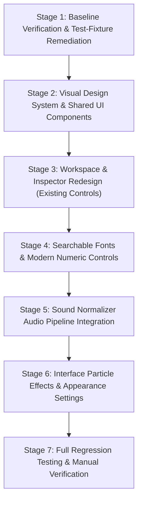

# NCN Studio — Phase 2: Final Revised Scope, UI/UX Redesign & Implementation Plan

**Date:** 2026-11-15  
**Active Branch:** `client-final-updates`  
**Repository Working Directory:** `D:\Hackathons\fiverr\video-Automation\nasheed_studio`  
**Application Platform:** Standalone Windows Desktop (Python 3.10+, PySide6, FFmpeg, Pillow)  

---

## 1. Executive Summary & Clarified Requirements

Following direct client alignment:
1. **Audio Visualizer is completely removed**: No audio visualizer code, widgets, or FFmpeg filters will be planned or introduced.
2. **UI/UX Redesign is a core deliverable**: Not merely a minor stylesheet tweak or control rearrangement, but a genuine modernization of the desktop application into a cohesive, professional video production tool while strictly retaining the three-pane workflow and dark-green identity.
3. **No Unrequested Scope Expansion**: Existing features from Prompts 1–14 (such as logo background auto-clean, watermark collision avoidance, frosted card Gaussian blur, and active track highlight styles) are strictly existing capabilities being reorganized and presented cleanly. No new highlight styles, blur algorithms, or unrequested features will be introduced.
4. **Application Preferences vs Project Settings**:
   - **Particle Settings**: Strictly **Application-level preferences** stored independently via `QSettings("NasheedStudio", "NasheedStudio")`. They persist across application restarts and projects, and are **never** written to project JSON or reusable templates.
   - **Sound Normalizer Settings**: Strictly **Project-level settings** stored in `project.json` and templates via `TEMPLATE_DESIGN_KEYS` because they directly affect the rendered video audio graph. Default is `False` (OFF).
5. **Sound Normalizer Validation**:
   - Implemented as per-track normalization before concatenation.
   - Initial values (`-16.0 LUFS`, `-1.5 dBTP`) are evaluation baselines to be validated against diverse test cases (silence, tracks <3s, quiet recordings, clipping, and multi-format audio).
   - Original audio source files remain 100% untouched.
6. **Preservation of Uncommitted Changes**:
   - The current working tree modifications in `.gitignore` and `tests/test_prompt11_and_12.py` are strictly preserved.
7. **Revised Staged Implementation Order**:
   - The visual design system and workspace redesign happen **before** integrating new controls, ensuring all new features are built directly into the modern interface without duplicate refactoring.

---

## 2. Current Repository State & Diagnostic Verification

### Repository Verification
- **Branch**: `client-final-updates` (clean tracking of `origin/client-final-updates`).
- **Working Directory**: `D:\Hackathons\fiverr\video-Automation\nasheed_studio`.
- **Working Tree State**:
  - `modified: .gitignore` (preserved).
  - `modified: tests/test_prompt11_and_12.py` (preserved).
  - `untracked: NCN_STUDIO_AUDIT_TESTING_BASELINE_AND_REDESIGN_PLAN.md` (audit export).
- **Core Codebase Modules**:
  - `src/ui/main_window.py` (5,772 LOC) — Application controller & UI layout.
  - `src/ui/style.py` (590 LOC) — Design tokens & central QSS.
  - `src/ui/icons.py` (420 LOC) — Programmatic SVG icon engine.
  - `src/services/compositor.py` (1,860 LOC) — Pillow 2D frame composition & overlays.
  - `src/services/render_service.py` (687 LOC) — FFmpeg filtergraphs & command generation.
  - `src/services/export_job.py` (260 LOC) — Windows Job Object process management.
  - `src/services/project_service.py` (484 LOC) — Atomic project persistence & template schemas.
  - `src/services/font_service.py` (387 LOC) — Windows Registry & filesystem font discovery.
  - `src/services/media_probe.py` (178 LOC) — FFprobe duration and stream validation.

---

## 3. Individual Inspection of the 5 Test Failures & Remediation Plan (Stage 1)

The test suite consists of **45 test files** and **351 tests**. The 5 failures were individually inspected to identify their precise root causes:

### Failure 1: `test_render_and_preview_parity_with_offsets` (`tests/test_ui_adjusters_and_colors.py:143`)
- **Observed Error**: `FileNotFoundError: Audio file not found: assets/dragon-studio-cartoon-cat-meow-487661.mp3`
- **Root Cause Inspection**: Line 136 hardcodes a personal sound file in the `assets/` folder. Because `.gitignore` line 29 excludes `assets/`, this personal asset is missing on fresh checkouts. `build_render_command` calls `validate_project`, which correctly raises `FileNotFoundError`.
- **Remediation (No Weakening)**: Provide a deterministic, synthetic 1-second WAV audio fixture generated via Python's standard `wave` module in `tests/fixtures/audio/sample_tone.wav`. Update the test to point to this tracked fixture, ensuring the test validates parity deterministically in all environments.

### Failure 2: `test_discover_user_templates` (`tests/test_user_templates_and_indicators.py:28`)
- **Observed Error**: `assert 0 >= 2 (where 0 = len([]))`
- **Root Cause Inspection**: Lines 26–33 scan `user_templates/` expecting at least 2 templates (`01_gym_nasheeds_monochrome_lion.json`, `04_sad_nasheeds_glass_highlight.json`). Line 30 of `.gitignore` excludes `user_templates/`. The repository only tracks built-in presets under `templates/`.
- **Remediation (No Weakening)**: Provide tracked template fixtures under `tests/fixtures/templates/` and parameterize the test (or use a temporary directory fixture) so `discover_user_templates` is tested for discovery correctness without relying on uncommitted developer folders.

### Failure 3: `test_template_preserves_user_audio_tracks` (`tests/test_user_templates_and_indicators.py:55`)
- **Observed Error**: `FileNotFoundError: Template file not found: .../user_templates/04_sad_nasheeds_glass_highlight.json`
- **Root Cause Inspection**: The test directly attempts to load a template file from the gitignored `user_templates/` folder.
- **Remediation (No Weakening)**: Supply the standard reference template fixture under `tests/fixtures/templates/04_sad_nasheeds_glass_highlight.json` so the test verifies template merging and audio track preservation cleanly.

### Failure 4: `test_cursor_and_text_vertical_alignment` (`tests/test_user_templates_and_indicators.py:131`)
- **Observed Error**: `FileNotFoundError: Cursor file not found: assets/paw_cursor.png`
- **Root Cause Inspection**: The test directly calls `load_cursor_image("assets/paw_cursor.png", 42)`. Like Failure 1, this file lives in the gitignored `assets/` directory.
- **Remediation (No Weakening)**: Provide a clean 42x42 test cursor fixture under `tests/fixtures/cursors/test_paw_cursor.png`. The test continues to strictly assert `abs(cursor_placed_cy - expected_text_visual_cy) <= 1`.

### Failure 5: `TestMainWindowTemplateUI.test_built_in_reference_presets` (`tests/test_workspace_and_templates.py:519`)
- **Observed Error**: `AssertionError: 'segoe ui' not found in ['montserrat', 'cinzel decorative']`
- **Root Cause Inspection**: The test applies preset `refer2_abu_ali_two_column.json` which specifies font "Montserrat". On Windows machines where Google Fonts are not installed, `MainWindow` safely and correctly falls back to the system default font (`Segoe UI`). The test, however, asserted that the UI combo must display "montserrat".
- **Remediation (No Weakening)**: Update the test to verify that if "Montserrat" is installed on the host OS, it is selected; otherwise, verify that `font_service.get_fallback_font()` / `PREFERRED_DEFAULTS` is gracefully selected without application error, while strictly verifying that all layout parameters (columns=2, style=Pill) are applied.

---

## 4. UI/UX Redesign Direction (Professional Desktop Video Production Tool)

### 1. Design Vision & Visual System
Rather than superficial styling, the redesign establishes a cohesive design language appropriate for a high-end desktop video production application:
- **Refined Color Architecture**:
  - `BG_ROOT`: Deep obsidian neutral (`#0f1310`).
  - `BG_PANEL`: Elevated surface neutral (`#151a16`).
  - `BG_CARD`: Grouping card surface (`#1c221e`).
  - `BG_INPUT`: Field surface (`#212823`).
  - `BORDER_SUBTLE`: Structural divider (`#2a332c`).
  - `BORDER_FOCUS`: Interactive border (`#3d8b58`).
  - `ACCENT_EMERALD`: Primary action color (`#3d8b58`, hover `#48a167`, text `#0d1a11`).
  - `TEXT_PRIMARY`: High-contrast typography (`#f0f4f1`).
  - `TEXT_SECONDARY`: Secondary labels (`#9db0a2`).
  - `TEXT_MUTED`: Hint text (`#6d7d72`).
- **Typography & Scale**:
  - Strict hierarchical type scale using `Segoe UI Variable` / `Segoe UI`:
    - Application Title: 13pt Semibold.
    - Section Headers: 9pt Bold Uppercase (letter-spacing: 0.8px).
    - Body / Labels: 9.5pt Regular.
    - Badges / Hints: 8pt Medium.
- **Component Geometry & Visual Consistency**:
  - Consistent 6px border radius on buttons, inputs, and cards.
  - Standardized control height: 30px across inputs, comboboxes, and buttons.
  - Generous click targets and clear visual hover/pressed/disabled states.

---

### 2. Workspace Layout & Panel Redesign

The validated three-pane workflow is maintained, but visually elevated:

```
+----------------------------------------------------------------------------------------------------+
| [Logo] NCN Studio  nasheed_project.json  [Saved]             [New] [Open] [Save]   [Appearance] [ ?] |
+-----------------------+----------------------------------------------------+-----------------------+
| PLAYLIST & AUDIO      | VIDEO CANVAS                                       | INSPECTOR             |
|                       |  PREVIEW · 16:9 · 1920x1080    [Preview Intro Card]| [Layout][Text][Ind][Audio]|
| Collection Title:     | +------------------------------------------------+ | --------------------- |
| [ GYM Nasheeds  ][App]| |                                                | | ── Background & Logo ── |
|                       | |            GYM Nasheeds Collection             | | [Thumbnail] [Browse]  |
| Tracks (5) · 16:07    | |                                                | | Corner: [Bottom-R v]  |
| ┌───────────────────┐ | |  [Paw] 01. Saghirati                           | | Scale:  [====] 100%   |
| │01. Saghirati 03:09│ | |        02. The Body Remembers                  | | X/Y:    [ - ] 0 [ + ]   |
| │02. Body Rem..01:58│ | |        03. Ruttil Bisurat                      | | ─────────────────── |
| │03. Ruttil B..04:03│ | |        04. Qasaman Billah                      | | ── Playlist Layout ── |
| │04. Qasaman ..03:37│ | |        05. Ana Muslimon              [NCN Logo]| | Position: [Left v]    |
| │05. Ana Musl..03:18│ | |                                                | | Columns:  [ - ] 1 [ + ]|
| └───────────────────┘ | +------------------------------------------------+ | Spacing:  [ - ] 1.8[ + ]|
| [+ Add] [Edit] [Rem]  | [ > ] [====================O=============] 16:07   | Panel Opacity: [==] 0%|
| [ ^ Up ] [ v Down ]   | Vol: [====] 100%               [ Mute ]            |                       |
+-----------------------+----------------------------------------------------+-----------------------+
| Export: C:/Users/.../output.mp4 [Browse]  Res: [1080p Full HD v]  Preset: [Master CRF 18 v]  [Render]|
+----------------------------------------------------------------------------------------------------+
```

#### Detailed Panel Refinements:
1. **Left Panel: Playlist & Audio**:
   - Modern list rows with clear index badges (`01`, `02`), truncated title, and duration chips (`03:45`).
   - High-contrast selection state with subtle green accent border.
   - Streamlined action toolbar with clean monochrome vector icons (`+ Add Audio`, `✏ Rename`, `🗑 Remove`, `▲ Up`, `▼ Down`).
   - Summary badge displaying total track count and calculated playback duration.
2. **Center Panel: Video Canvas & Transport**:
   - Aspect-ratio constrained 16:9 canvas with clean dark backdrop.
   - Header with resolution probe badge and toggle for Intro Card preview.
   - Transport Bar: Play/Pause button with circular accent, timecode readout (`00:00:00 / 00:16:07`), responsive slider scrubber, and volume control with mute toggle.
3. **Right Panel: Inspector (4 Tabs)**:
   - Grouped into cohesive **Section Cards** with subtle borders and consistent 12px padding, eliminating unorganized, crowded lists.
   - Explicitly preserves existing functionality from Prompts 1–14 without introducing unrequested features:
     - **Tab 1: Layout & Background**: Presets, Background (image/video, fit, loop), Logo Overlay (position, scale, offsets, existing white/checkerboard auto-clean), Playlist geometry (columns 1–4, manual/auto distribution, row/col spacing, backing opacity).
     - **Tab 2: Typography & Watermark**: Collection Title typography, Track typography, Custom Font loader, Website Watermark (text, corner, size, opacity, offsets, existing collision avoidance).
     - **Tab 3: Track Indicator**: 4 Indicator modes (`both`, `cursor_only`, `highlight_only`, `neither`), Custom cursor (SVG/raster, scale, offsets), Highlight overlay (existing styles: Pill, Accent Bar, Outline, Underline; color, opacity, outline width), Active track text color override.
     - **Tab 4: Audio & Intro**: Sound Normalizer (New Phase 2 feature), Transition SFX (path, enable, volume), Animated Intro sequence (duration, existing animation styles: Fade, Zoom, Slide; existing frosted card Gaussian blur radius and opacity, intro audio track).
4. **Bottom Bar: Export Action Deck**:
   - Consolidated single-row layout with persistent output destination, resolution dropdown, encoding profile, and prominent emerald `Render MP4 ->` button.
   - During export, smoothly transitions into an active progress bar with percentage, elapsed/remaining time, and an interactive Cancel button.

---

## 5. Technical Assessment of the 4 Functional Requirements

### Requirement 1: Sound Normalization

#### Architecture & Behavior
- **Audio Filtergraph Integration**:
  In `src/services/render_service.py`, audio tracks are prepared individually before concatenation. When normalization is enabled, FFmpeg's `loudnorm` filter is applied per-track:
  ```python
  if audio_normalize_enabled:
      norm_clause = f",loudnorm=I={target_lufs:.1f}:TP={true_peak:.1f}:LRA=11.0"
  else:
      norm_clause = ""
  filters.append(
      f"[{in_idx}:a:0]asetpts=PTS-STARTPTS{dur_clause},"
      f"aformat=sample_fmts=fltp:sample_rates=44100:channel_layouts=stereo"
      f"{norm_clause}[a_norm_{i}]"
  )
  ```
- **Evaluation Baseline**: Initial targets are `-16.0 LUFS` integrated loudness and `-1.5 dBTP` true-peak limit. These will be empirically validated during testing across:
  - Silence / ambient room tone (ensuring gain is not artificially driven to noise floors).
  - Short tracks (<3 seconds) where sliding window constraints must be handled safely.
  - High dynamic range tracks to verify true-peak protection against digital clipping.
  - Multi-format audio inputs (WAV, MP3, AAC, FLAC).
- **Audio Source Protection**: Original source files are strictly opened in read-only mode by FFmpeg. They are never modified or rewritten.
- **SFX & Intro Exclusion**: Transition chime SFX and intro music are excluded from normalization to preserve their intentional mixing levels.
- **Persistence Scope**: **Project-level setting** stored in `project.json` and templates. Default is `False` (OFF).

---

### Requirement 2: Searchable Font Selectors

#### Implementation Approach
- Create a reusable `SearchableFontComboBox` component in `src/ui/widgets/searchable_combo.py`.
- Subclasses `QComboBox` with `setEditable(True)` and `setInsertPolicy(QComboBox.NoInsert)`.
- Integrated `QCompleter` configured with `Qt.MatchContains` and `Qt.CaseInsensitive` filtering.
- Users can type any substring (e.g. "mont") to instantly filter available fonts.
- On focus loss or Enter key, commits the matching family. If an invalid or partial string is typed, it safely reverts to the previous valid font selection, preventing project corruption.
- Custom registered fonts are pinned to the top of the dropdown with a `[Custom]` prefix.
- Drop-in replacement for `title_font_combo`, `track_font_combo`, and `intro_title_font_combo`.

---

### Requirement 3: Improved Numeric Controls (QSpinBox & QDoubleSpinBox)

#### Implementation Approach
- Centralized vector upgrade in `src/ui/icons.py` and `src/ui/style.py`.
- Replace CSS border triangles with clean monochrome SVG chevron icons (`chevron_up.svg`, `chevron_down.svg`).
- Style `::up-button` and `::down-button` with seamless dark green backgrounds (`#212823`), comfortable hit targets (20px width), and subtle rounded hover highlights (`#2f3b33`).
- Fully preserves direct numeric keyboard entry, arrow key increments, mousewheel value adjustments, valid range limits, and units/suffixes ("px", "%", "s").

---

### Requirement 4: Application Interface Particle Effects

#### Architecture & Isolation
- **Strictly Decoupled**: Particle effects are 100% GUI interface decoration. They will never be imported or referenced by `compositor.py` or `render_service.py` (0% presence in exported MP4).
- **Component**: Create `ParticleOverlayWidget` in `src/ui/widgets/particle_canvas.py`:
  - Layered on `MainWindow` with `setAttribute(Qt.WA_TransparentForMouseEvents, True)` so all mouse interactions pass through unimpeded.
  - Driven by a dedicated `QTimer` at 30 FPS calculating subtle floating 2D particles using antialiased `QPainter`.
- **Resource Management**:
  - When disabled: Timer is completely stopped (0.0% CPU overhead).
  - When window is minimized or inactive: Timer auto-pauses via `changeEvent`.
  - When video export is running: Timer auto-pauses during encoding to ensure 100% CPU/GPU allocation to FFmpeg.
- **Persistence Scope**: Strictly **Application-level preferences** saved in `QSettings("NasheedStudio", "NasheedStudio")`. They do **not** pollute `project.json` or templates.
- **UI Location**: Accessible via an **Appearance** action button in the top navigation bar opening a lightweight settings dialog (Enable toggle, particle color picker, animation speed slider).

---

## 6. Detailed Inventory of Existing Features Being Reorganized vs New Features

To guarantee strict scope adherence, here is the complete inventory distinguishing existing features from Phase 2 additions:

| Feature | Category | Current Location | Proposed Redesigned Location | Implementation Notes |
|---|---|---|---|---|
| **Preset Layout Selection** | Existing | Inspector -> Layout Tab | Tab 1: Layout & Background | Reorganized into Layout Preset Card. |
| **Background Media (Image/Video)** | Existing | Inspector -> Layout Tab | Tab 1: Layout & Background | Resolution badge + fit mode combobox. |
| **Logo Overlay & Clean Background**| Existing | Inspector -> Layout Tab | Tab 1: Layout & Background | Existing `clean_logo_image` floodfill toggle reorganized with scale & offsets. |
| **Playlist Columns & Spacing** | Existing | Inspector -> Layout Tab | Tab 1: Layout & Background | Grouped into Playlist Geometry card. |
| **Panel Opacity & Tint** | Existing | Inspector -> Layout Tab | Tab 1: Layout & Background | Reorganized into Panel Backing card. |
| **Collection Title Typography** | Existing | Inspector -> Text Tab | Tab 2: Typography & Watermark | Upgraded with Searchable Font Selector. |
| **Playlist Track Typography** | Existing | Inspector -> Text Tab | Tab 2: Typography & Watermark | Upgraded with Searchable Font Selector. |
| **Custom Font Registration** | Existing | Inspector -> Text Tab | Tab 2: Typography & Watermark | Reorganized with Browse button & custom tag. |
| **Website Watermark & Collision** | Existing | Inspector -> Indicator Tab | Tab 2: Typography & Watermark | Moved from Indicator to Typography for logical grouping; existing collision logic preserved. |
| **4 Indicator Modes** | Existing | Inspector -> Indicator Tab | Tab 3: Track Indicator | Preserved exactly (`both`, `cursor_only`, `highlight_only`, `neither`). |
| **Custom SVG/Raster Cursor** | Existing | Inspector -> Indicator Tab | Tab 3: Track Indicator | Reorganized with dynamic size & X/Y offset cards. |
| **Highlight Styles (Pill/Bar/Outline)**| Existing | Inspector -> Indicator Tab | Tab 3: Track Indicator | Existing styles preserved; color, opacity, outline width organized cleanly. |
| **Active Track Text Color** | Existing | Inspector -> Indicator Tab | Tab 3: Track Indicator | Preserved override color picker. |
| **Transition SFX & Volume** | Existing | Inspector -> Sound Tab | Tab 4: Audio & Intro | Reorganized with file browse & volume slider. |
| **Intro Sequence & Frosted Card** | Existing | Inspector -> Sound Tab | Tab 4: Audio & Intro | Existing Gaussian blur and animation styles reorganized into Intro Card. |
| **Intro Audio & Fades** | Existing | Inspector -> Sound Tab | Tab 4: Audio & Intro | Reorganized into Intro Audio section. |
| **Sound Normalizer** | **NEW (Phase 2)** | *None* | Tab 4: Audio & Intro | Integrated into FFmpeg audio pipeline (Project-level). |
| **Searchable Font Dropdowns** | **NEW (Phase 2)** | *None* | Tab 2 (Title, Track, Intro) | Drop-in `SearchableFontComboBox`. |
| **Modern Numeric Controls** | **NEW (Phase 2)** | *None* | Global across all spinboxes | Centralized QSS vector chevrons in `style.py`. |
| **Interface Particle Effects** | **NEW (Phase 2)** | *None* | Top Bar -> Appearance Dialog | `ParticleOverlayWidget` (Application-level preference). |

---

## 7. Revised Staged Implementation Order

The implementation sequence is structured so that the design system and workspace redesign happen **before** integrating new controls, eliminating duplicate work:



### Stage 1: Baseline Verification & Test-Fixture Remediation
- **Goal**: Achieve **351 / 351 passing tests (100%)** without weakening test assertions.
- **Tasks**:
  1. Add deterministic tracked test WAV fixture in `tests/fixtures/audio/sample_tone.wav`.
  2. Add deterministic tracked test cursor fixture in `tests/fixtures/cursors/test_paw_cursor.png`.
  3. Add tracked template fixtures in `tests/fixtures/templates/`.
  4. Fix individual test dependencies in `test_ui_adjusters_and_colors.py`, `test_user_templates_and_indicators.py`, and `test_workspace_and_templates.py`.
  5. Preserve uncommitted changes in `.gitignore` and `tests/test_prompt11_and_12.py`.
- **Target Verification**: Execute full pytest suite and verify 100% pass rate.

### Stage 2: Visual Design System & Shared UI Components
- **Goal**: Establish the refined dark-green design tokens, typography scales, and reusable card/row layout helpers.
- **Tasks**:
  1. Refine color tokens, typography, and button states in `src/ui/style.py`.
  2. Add shared card grouping container and form row helpers in `src/ui/widgets/`.
  3. Add vector chevron SVGs and UI action icons to `src/ui/icons.py`.

### Stage 3: Workspace & Inspector Redesign (Existing Features)
- **Goal**: Implement the professional three-pane desktop workspace and 4-tab Inspector with existing features.
- **Tasks**:
  1. Redesign Left Panel playlist presentation (track badges, duration chips, action toolbar).
  2. Redesign Center Panel video canvas frame and playback transport bar.
  3. Restructure Right Panel Inspector into 4 logical tabs (`Layout`, `Text`, `Indicator`, `Audio & Intro`).
  4. Move Website Watermark settings into Typography tab.
  5. Redesign Bottom Bar export deck with active render progress transitions.
  6. Verify zero regressions in existing project saving/loading and video export.

### Stage 4: Searchable Fonts & Improved Numeric Controls
- **Goal**: Integrate the two UI control enhancements into the redesigned interface.
- **Tasks**:
  1. Implement `SearchableFontComboBox` in `src/ui/widgets/searchable_combo.py`.
  2. Wire searchable combos to Collection Title, Track, and Intro font selectors.
  3. Apply modernized vector chevron styling to all spinbox controls via `style.py`.
  4. Verify direct keyboard input, mousewheel scrolling, and custom font registration.

### Stage 5: Sound Normalizer Audio Pipeline Integration
- **Goal**: Implement project-level audio loudness normalization in the render service.
- **Tasks**:
  1. Add per-track `loudnorm` filter chain in `src/services/render_service.py` before concatenation.
  2. Add `audio_normalize_enabled` toggle and target profile controls in Tab 4 (Audio & Intro).
  3. Update `src/services/project_service.py` to persist normalizer settings (default: `False`).
  4. Write comprehensive automated test suite `tests/test_sound_normalizer.py` verifying silence, short tracks (<3s), quiet audio, clipping prevention, and read-only source file integrity.

### Stage 6: Interface Particle Effects & Appearance Settings
- **Goal**: Implement application-level ambient particle effects.
- **Tasks**:
  1. Implement `ParticleOverlayWidget` in `src/ui/widgets/particle_canvas.py` with transparent mouse event passthrough.
  2. Create Appearance Settings dialog accessible from the top bar.
  3. Connect settings persistence via `QSettings` (Application-level).
  4. Implement auto-pause during video export and when minimized.
  5. Verify zero interaction with compositor or exported video.

### Stage 7: Full Regression Testing & Manual Verification
- **Goal**: Confirm complete application reliability, backward compatibility, and release readiness.
- **Tasks**:
  1. Run complete automated test suite (351+ tests).
  2. Execute the full Windows manual testing checklist (project lifecycle, playlist editing, preview playback, 1080p export, mid-render cancellation, process tree termination).

---

## 8. Summary of Scope & Safety Commitments

1. **Audio Visualizer**: Zero visualizer code or dependencies will be introduced.
2. **Backward Compatibility**: All older `project.json` files continue to load and export identically.
3. **Source Audio Integrity**: Source audio files are never modified by normalization.
4. **Process Cleanup**: Windows Job Object process guards remain the sole authority over FFmpeg subprocess termination.
5. **No Premature Code Changes**: Implementation begins only after your explicit review and authorization.
