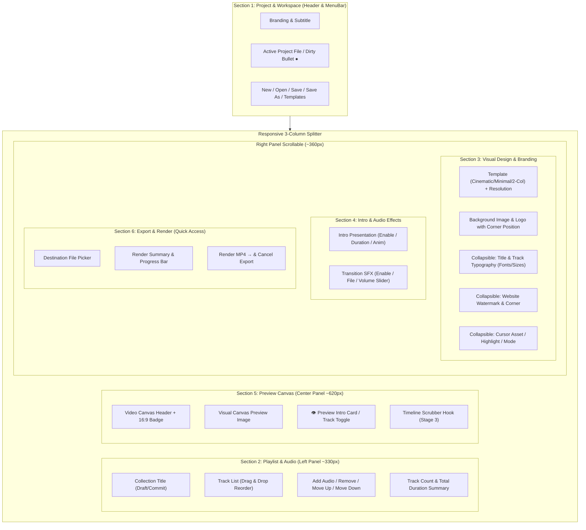

# Stage 2: UI Reorganization Proposal

## 1. Executive Summary

This proposal outlines the structural reorganization of the Nasheed Studio PySide6 user interface. The redesign transitions the interface from an unorganized, 8-box stacked scroll pane into **six cohesive functional sections** while preserving **100% of existing functionality, data bindings, and test-automation attributes**.

---

## 2. Six Functional Sections & Assigned Controls

### Section 1: Project & Workspace
* **Location:** Application Header Bar & Project MenuBar.
* **Purpose:** Clean project lifecycle, dirty-state visibility, template application, and direct workspace access.
* **Assigned Controls & Indicators:**
  - Branding: `title_lbl` ("Nasheed Studio") and `subtitle` ("PLAYLIST VIDEO AUTOMATION").
  - Project Title & Dirty Status: `self.project_status_label` (e.g. `Abu_Ali.nasheed*` with bullet `●` for unsaved changes).
  - Quick Project Actions:
    - `New Project` (`self.new_project`)
    - `Open` (`self.open_project`)
    - `Save` (`self.save_project`, visual highlight if dirty)
    - `Save As...` (`self.save_project_as`)
  - Project Menu:
    - *New Project*, *Open Project…*, *Open Recent* (recent projects sub-menu).
    - *Save Project*, *Save Project As…*.
    - *Save as Reusable Template…*, *Apply Reusable Template…*.
    - *Open Workspace Directory* (reveals `projects/`, `exports/`, `temp/` in Windows Explorer).

---

### Section 2: Playlist & Audio Management
* **Location:** Left Column (default width: 330px, minimum width: 280px).
* **Purpose:** Content curation, track sequence, duration overview, and title drafts.
* **Assigned Controls:**
  - Collection Title Editor:
    - `self.collection_title` (QLineEdit) with draft editing.
    - `self.title_apply_btn` (QPushButton "Apply") with keyboard shortcut tooltips (`Enter` to apply, `Esc` to cancel).
    - Auto-apply debounced timer (1.5s).
  - Track Management:
    - `self.track_list` (QListWidget) with drag-and-drop reordering, double-click rename, high-contrast dark theme selection styling.
    - Playlist Action Row: `＋ Add audio` (`self.add_tracks`), `Remove` (`self.remove_track`).
    - Reorder Action Row: `↑ Move up`, `↓ Move down` (`self.move_track`).
    - Summary Badge: Total tracks count and total running time (e.g., `5 tracks · 18m 42s`).

---

### Section 3: Visual Design & Branding
* **Location:** Right Column — Upper Section (Scrollable Area, width ~360px).
* **Purpose:** Unifies all visual composition assets and styling controls (previously scattered across left and right panels).
* **Assigned Controls:**
  - Layout & Base Assets:
    - `self.template_combo` ("Cinematic", "Minimal", "Two-column").
    - `self.resolution_combo` (1080p, 1440p, 4K UHD) with `self.fps_label`.
    - `self.background_label` (with elided filename + tooltip) & `self.background_btn`.
    - `self.logo_label` (with elided filename + tooltip) & `self.logo_btn`.
    - `self.logo_pos_combo` ("Bottom-Right", "Bottom-Left", "Top-Right", "Top-Left").
  - Typography Drawer (Collapsible):
    - Collection Title font family (`self.title_font_combo`), style (`self.title_style_combo`), size (`self.title_size_spin`).
    - Playlist Tracks font family (`self.track_font_combo`), style (`self.track_style_combo`), size (`self.track_size_spin`).
    - `self.refresh_fonts_btn` ("🔄 Refresh system fonts").
  - Branding Watermark & Cursor Drawer (Collapsible):
    - `self.website_edit` (watermark text), `self.website_pos_combo`, `self.website_size_spin`.
    - `self.overlap_warning` (auto-adjust collision warning label).
    - `self.indicator_combo` ("Both", "Cursor only", "Highlight only", "Neither").
    - `self.cursor_label`, `self.cursor_btn`, `self.cursor_reset_btn`, `self.cursor_size_spin`.

---

### Section 4: Intro & Audio Effects
* **Location:** Right Column — Middle Section.
* **Purpose:** Dynamic transitions and opening card settings.
* **Assigned Controls:**
  - Opening Sequence:
    - `self.intro_check` (Enable intro sequence).
    - `self.intro_dur_spin` (Duration: 1.0s – 10.0s).
    - `self.intro_anim_combo` ("Fade in / out", "Zoom in", "Slide").
  - Transition Sound Effects:
    - `self.sfx_check` (Enable transition SFX).
    - `self.sfx_label` (with elided filename + tooltip), `self.sfx_btn`, `self.sfx_reset_btn`.
    - `self.sfx_vol_slider` (0–100%) and `self.sfx_vol_label`.

---

### Section 5: Preview Canvas
* **Location:** Center Column (Expanding width ~620px+).
* **Purpose:** High-fidelity composition inspection and time navigation.
* **Assigned Controls:**
  - Header: Section title ("VIDEO CANVAS") and resolution badge (`self.preview_badge`, e.g. `PREVIEW · 16:9 · 1080p`).
  - Canvas Viewport:
    - `self.preview_frame` with `self.preview_image` (Pillow composited preview scaled cleanly to 16:9 aspect ratio).
  - Mode Switch & Toolbar:
    - `self.preview_intro_btn` ("👁 Preview Intro Card" / "📋 Preview Composition").
  - Timeline Scrubber Hook (Stage 3 Ready):
    - Time-navigation slider with track/intro boundary ticks.

---

### Section 6: Export & Render
* **Location:** Right Column — Bottom Section (Pinned or accented so it is immediately accessible without scrolling).
* **Purpose:** Safe staged video publishing and background export monitoring.
* **Assigned Controls:**
  - Destination Path:
    - `self.output_edit` (pointing to `<workspace>/exports/...`).
    - Browse button (`self.choose_output`).
  - Job Status & Summary:
    - `self.render_summary` (Track count, resolution, total duration).
    - `self.progress` (QProgressBar).
    - `self.status_label` ("Ready when you are.").
  - Execution Controls:
    - `self.render_btn` ("Render MP4 →", `#primary` styling).
    - `self.cancel_btn` ("Cancel Export", `#cancel` styling, visible only during active job).
  - Encoder Resource Profile Hook (Stage 4 Ready):
    - Profile combo: Background-friendly / Balanced / Maximum-speed.

---

## 3. Preserving Stability, Constraints & Compatibility

1. **Complete Attribute Preservation:**
   All 55+ UI widget attribute names referenced by the existing test suite (`collection_title`, `title_apply_btn`, `track_list`, `output_edit`, `render_btn`, `cancel_btn`, `overlap_warning`, `intro_check`, etc.) remain identical on `MainWindow`. No attributes are removed or renamed.
2. **Long Filename Protection (Bug A):**
   All file labels (`background_label`, `logo_label`, `sfx_label`, `cursor_label`) enforce `maximumWidth(260)` with middle ellipsis truncation and full path tooltips. Panels cannot be pushed or resized by long imported file paths.
3. **Selection Contrast (Bug B):**
   Full stylesheet isolation for `QListWidget::item:selected`, `:active`, `:!active`, and `:hover` remains active (`#2e5c3e` background with `#e8f5ec` text) preventing unreadable black-on-black states.
4. **Export Safety & Process Ownership (Bug C & Stage 1):**
   All render invocations continue to use isolated workspace staging (`temp/render_<jid>/`), two-phase replace rollback, and Windows Job Object process tree termination.
5. **Display Scaling & Resizing:**
   Window minimum size maintained at `1120x720` with default `1440x900`. `QSplitter` enforces `childrenCollapsible(False)` and proportional weight distribution `[330, 620, 360]`.

---

## 4. Verification Plan for Stage 2

1. **Unit & Widget Test Suite:**
   Run full `pytest tests/` (108 tests) to confirm zero regressions in widget hooks, signal bindings, or dirty-state transitions.
2. **Visual Inspection:**
   Run an off-screen/on-screen widget tree inspection script verifying all 6 sections exist, all buttons are linked, and layout geometry meets specifications.
3. **Stage 1 Safety Verification:**
   Ensure atomic saving, template extraction, and staged exports operate seamlessly within the reorganized UI.
